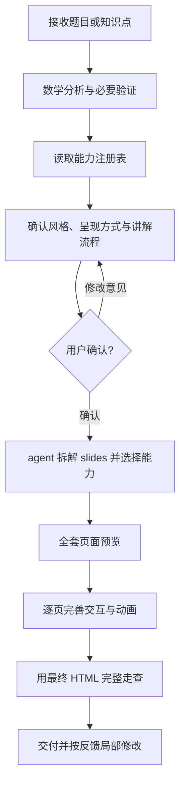

# 数学动态讲解

把数学知识点或题目做成教师主导的分步讲解。以在线 HTML 为主交付，同一份 HTML 可下载后在联网状态下直接打开。先确认教学方案，再预览全套页面，最后逐页完善交互和动画。修改已有课件时另存新版本。总体框架见 [README](README.md)。

## 工作步骤

1. **分析题目。** 核对受众、目标、条件、结论和推理。需要证明时给出数学依据。查看[能力注册表](capabilities/README.md)。
2. **确认方案。** 提出讲解目标、风格、呈现形式、推进顺序和关键停顿。用一句话说明关键一幕在屏幕上怎样变化。结合已有偏好选择“趣味化讲解 · 彩色”或“专业化讲解 · 严谨克制”，只确认影响方案或数学结论的问题。
3. **规划页面。** 教师确认后，按[视觉设计指南](references/visual-design.md)规划每页的讲解目标、主视觉、学生所见内容、揭示步骤和衔接。按需读取所选能力的说明。能力限制若影响讲解目标或核心体验，说明并确认调整。
4. **先出全套预览。** 在同一个 HTML 中排齐全部页面，使用真实题干、公式和图形。用点击切换关键状态，走查页面顺序、视觉焦点、停顿和答案揭示，并接入已规划的音效。在一页图文并存的课件上试验大小窗口间的同步缩放。遇到依赖变形、拖拽或图式联动的关键页，先试做最难的一段。教师要求先看预览时在此交付并等反馈，其余任务自检后继续。
5. **逐页完善。** 加入服务于讲解的动画和操作，每改完一页，连同相邻页验证前进、回退、揭示顺序和对象连续性。
6. **走查交付。** 用浏览器打开最终 HTML，完整走查推理、画面、交互及目标屏幕上的布局，确认课件内无教师讲解提示，按[屏幕适配与预览](references/visual-design.md#屏幕适配与预览)实测画布缩放。验证首次触发、静音开关和切页后的音效表现。分别报告数学核对和运行验证结果。
7. **局部修改。** 检查教师指定版本的代码、素材和工具工程，修改相关页面并另存。涉及画面、动效或适配时读取视觉设计指南，复验受影响的步骤及相邻页。

## 能力与实现自由

能力说明提供用途、调用入口、输入输出、限制和必要参考，供 agent 组合使用。同一 slide 可以组合文字、公式、几何、生成图片及其他合适的表达；导航、版式和动效按教学意图设计。除下列默认能力外，其他能力按教学需要选用。

## 约束

- 生成前必须等教师确认教学方案。
- **教师提示只写在回复正文里。** 按页或步骤简述提问、停顿和揭晓时机。预览和成品仅保留学生所需内容与演示控件，教师提示也不得写入隐藏备注或内嵌数据。
- **课堂演示内容随课件画布整体等比缩放。** 预览和最终 HTML 都要让文字、公式、图形、标注及页内交互控件共享同一缩放比例。播放器导航、全屏和静音等外部控件可独立布局。
- **几何主图默认用 `algeo-sdk`。** 题干引用或推理依赖的几何图都适用，包括图形固定、只做标注或分步高亮的题。优先使用原生几何对象和分步揭示，统一线型与标注，让图形和推导同步。
- **新课件默认自带音效，且声音开关默认开启。** 用户明确要求无音效时才省略。规划页面时读取[音效说明](capabilities/sound-effects.md)，在技能根目录运行 `node scripts/select-sound-effects.cjs <语义 ID> [...]`，为实际教学事件选音，将素材内嵌到 HTML 并接入触发逻辑。纯讲解课件也至少为一次关键条件、公式或推理步骤的揭示配音效。
- 在能力注册表中登记新能力，并提供独立用途、入口、输入输出与边界说明。不要把工具调用细节加入第一轮用户确认流程。
- **默认联网交付。** 同一份 HTML 在联网状态下可通过 `file://` 双击打开，无需启动 HTTP 服务。仅在用户明确要求断网运行时，将离线兼容性纳入选型；若影响几何主图的呈现，先说明取舍。
- 数学正确性与实际呈现分别核对，不把工具调用成功或代码生成完成等同于讲解验证通过。
